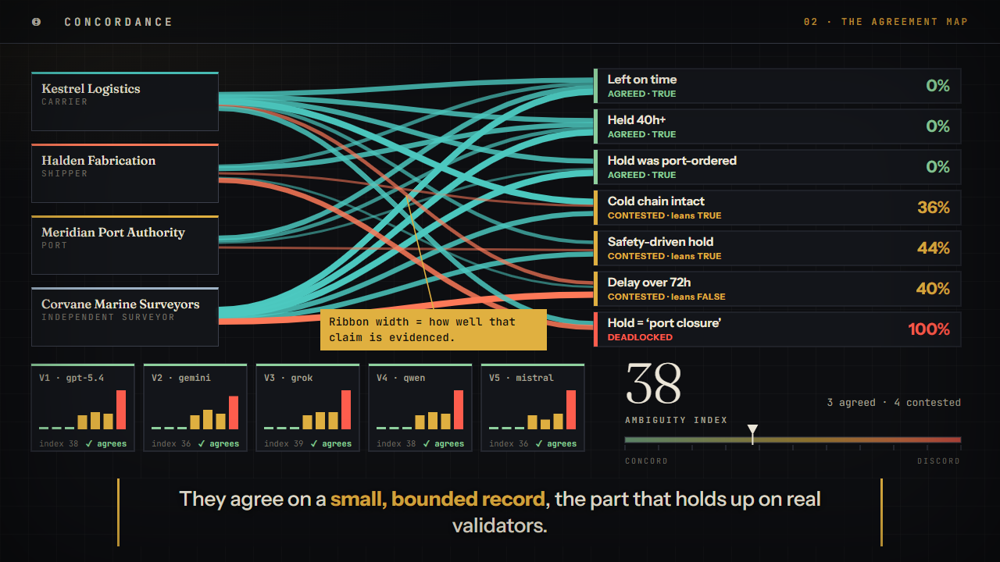
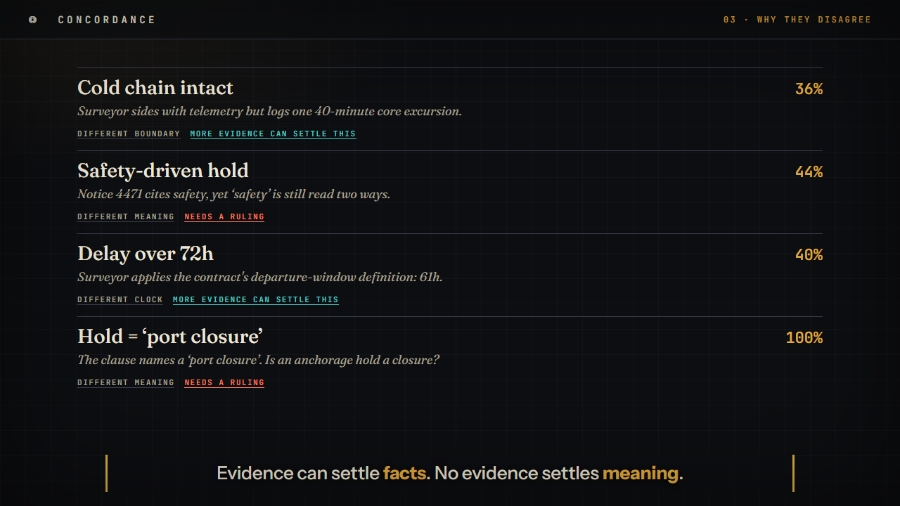
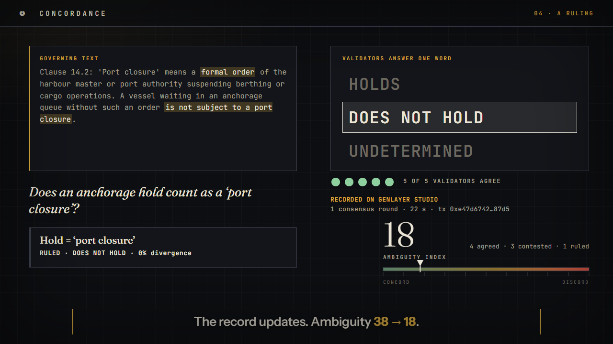
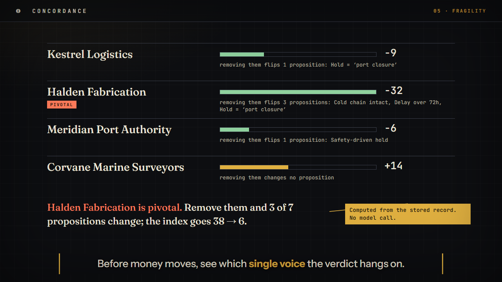
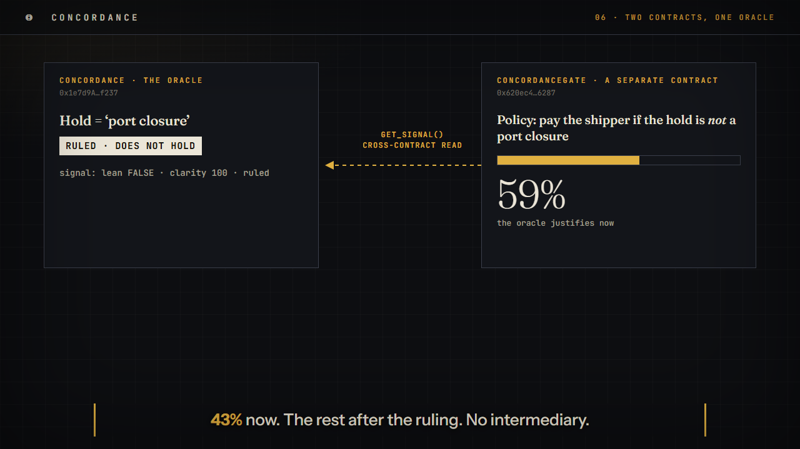
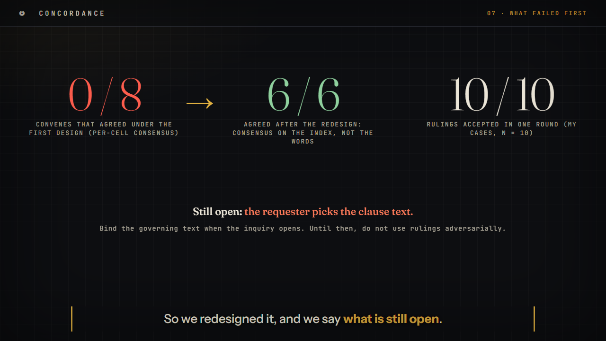

# The oracle that refuses to lie about disagreement

### Concordance: an inter-subjective oracle on GenLayer, where validators agree on what is settled, what is contested, and why

*A shipment of semiconductor wafers arrives late, and possibly warm. The carrier says the port ordered the hold. The shipper says nobody closed the port. The port says it issued no hold. A surveyor says notice 4471 exists. Ask a normal oracle who is right and it will answer in one word. That word is the problem.*

Almost every oracle collapses disagreement into a single answer: true or false, accepted or rejected, a number. That is fine when the world is unambiguous. It is a bad fit for the places where blockchains most want to reach, such as insurance, supply chains, escrow, grants and agent-to-agent commerce, because those are exactly the places where honest parties describe the same situation differently.

**Concordance** keeps the disagreement. Independent validators running different models read every party's account, and the network agrees on a structured record of *what is settled, what is contested, how contested, and why*. Contracts then act on that record, with money moving in proportion to how settled the facts really are.

It is live on GenLayer Studio. There is a [showcase demo with a guided tour](https://concordance-web.vercel.app/), a [public app](https://concordance-web.vercel.app/app.html) where anyone can open their own inquiry, and the [source, MIT licensed](https://github.com/s70239176-ctrl/concordance). A 90-second film walks through the whole thing, and its soundtrack is driven by the ambiguity number: you can hear the disagreement.

## Why this needs GenLayer

A normal smart contract cannot read a surveyor's report. An oracle network can fetch one, but it will usually have to collapse the answer to something every node can reproduce byte for byte. GenLayer's equivalence principle is different: validators may disagree on wording as long as they agree on meaning under a rule the contract defines. That is what makes this design possible.

Two details matter. First, *model diversity is the signal, not the noise.* Disagreement between the parties is the product. Disagreement between validators is the risk, so the contract keeps the language model on a short leash: it only reads, assigning each party a stance (affirms, denies, silent) and an evidence strength per proposition. Everything that moves money, the divergence, the status, the ambiguity index, the release percentage, is derived in plain deterministic code. Second, evidence is untrusted input. A deterministic scan flags instruction-like text and caps that party's weight before anything is derived, so an attacker who tries to steer the record loses influence instead of gaining it.

## What it produces

The unit is an *inquiry*: a question, a handful of weighted propositions, and one account (plus evidence) per party. When validators convene, the contract records, for each proposition, whether it is agreed, contested, deadlocked or unsupported, how far apart the parties are (divergence, 0 to 100), and a one-line crux. The whole inquiry gets one number, the **ambiguity index**, drawn in the interface as a tuning scale from concord to discord.

Then it does something about each class of dispute.

Disputes over facts, clocks and boundaries can be settled with more evidence, so you reconvene. Disputes over *meaning*, such as whether an anchorage hold counts as a "port closure," cannot. No amount of evidence settles what a clause means.

## The part where our first design failed

We should be honest about how this ended up the way it is. The first version asked validators to agree, proposition by proposition, on the status and divergence of every cell in the table. We tuned that rule against synthetic noise (random wobble on a fraction of cells) and it looked excellent: 97.5% of simulated honest validators matched the leader.

On real GenLayer Studio validators, **none of the eight convenes we ran reached agreement.** Each exhausted all four leader rotations and ended `UNDETERMINED`. The leader rotation, as it turned out, doubles as an experiment: each rotation uses a different model on identical inputs, so one transaction hands you up to four independent readings of the same evidence. Scored pairwise, the old rule accepted **1 of 24** real model pairs. Models agreed on how contested the whole situation was (their ambiguity indices were within 20 points of each other for 92% of pairs), but not on any single cell.

| | Synthetic noise (what we tuned on) | Real multi-model records |
|---|---|---|
| Pairs the original rule accepts | 97.5% | **1 of 24** |
| On-chain outcome | n/a | 0 of 8 convenes agreed |
| Redesigned rule, held-out records | n/a | 10 of 12 pairs |
| Redesigned rule, on-chain | n/a | **6 of 6 convenes agreed, first round** |

So we redesigned the consensus surface. Validators now ratify the ambiguity index (within a tolerance), the rough class of each proposition, and the absence of outright contradiction. The per-proposition map is the leader's annotation, ratified only at that coarse granularity. That is a weaker guarantee and we say so plainly: **sell the index and the no-contradiction check, not the cell-by-cell map as network-verified fact.** The measurement, including the part that failed, is in the repository.

## Rulings: one narrow question, one word

The lesson of that failure shaped the next feature. Validators cannot agree on rich output, but they can agree on a small, bounded answer. So when a dispute is about meaning, anyone can call `request_ruling` and put one question to the validators: *does this proposition hold as a matter of what the governing text says?* The only allowed answers are `HOLDS`, `DOES_NOT_HOLD` and `UNDETERMINED`. Consensus ratifies only that word.

A ruling never edits the stored record. An *effective* record applies it on read: the proposition becomes settled, the index is recomputed, and everything downstream (the signal other contracts read, escrow release) sees the effective record. If the answer depends on facts the text does not settle, the right answer is `UNDETERMINED`, and nothing changes.

On Studio, **all 10 rulings we ran were accepted in a single consensus round**, 16 to 29 seconds each, with the verdicts we intended, including two fact-dependent questions that correctly came back `UNDETERMINED`. Rulings took one inquiry's ambiguity index from 100 to 20. Read that number with its caveats: we wrote the test clauses and the intended verdicts ourselves, and ten is a small sample. It shows the mechanism reaches consensus and behaves sensibly, not that it is accurate on hard law.

## Who holds the verdict up

Before money moves, it is worth knowing whether the result hangs on one person. The **fragility map** removes each party in turn and re-derives the record, reporting which propositions change class or lean. On the demo's second round, removing the shipper flips three of seven propositions and drops the index from 38 to 6: the verdict leans on one voice. It is computed from the stored record alone, so there is no model call and nothing new to agree on, and it works on every inquiry already on-chain.

## One oracle, two contracts

An oracle nobody consumes is a demo. So `ConcordanceGate` is a separate Intelligent Contract that locks funds against a policy ("pay the shipper if the hold is *not* a port closure") and, when anyone calls `claim`, reads Concordance's signal **across contracts** and pays by it. The GenLayer documentation does not say whether a view call is allowed inside a write transaction. It is, and the gate depends on it.

On Studio, through the public interface: the gate paid **43%** while the dispute was open, a ruling was requested in the oracle contract, and the next claim paid the remaining **57%**, with the policy history recording which proposition was ruled. A second claim and a claim on an unruled, deadlocked proposition were both refused, and a refund after closing the inquiry returned the reserve with the gate's balance matching its open policies. The gate's code did not change. The oracle did.

## How we know what we know

| Check | Result |
|---|---|
| Local tests (stubbed SDK) | 60 passing: derivation, equivalence, escrow conservation, rulings, fragility, the gate |
| JavaScript vs Python parity | the demo's derivation matches the contract on the demo, on 300 random inputs, and on all 24 real model records |
| Real validators, convening | 6 of 6 agreed after the redesign (0 of 8 before) |
| Real validators, rulings | 10 of 10 in one round (my cases, n = 10) |
| Escrow and gate on Studio | releases matched the prediction to the wei; every guard reverted; funds conserved |
| Live site | tested end to end on the deployed site, which found and fixed 11 bugs |

## Design choices worth knowing

- **The model reads; code decides.** Anything that moves money is deterministic.
- **Releases only ratchet up.** If a later round is *more* ambiguous, funds already paid are not clawed back. That is a choice, not a law.
- **Rulings are final and the record is immutable.** Applying a ruling is a view-time operation.
- **The demo replays recorded readings.** Real models produced noisier numbers than the scripted story (the index ranged from 60 to 82 with no clean drop after round two), and the interface lets you replay both side by side.

## Known limits

- **The requester supplies the governing text for a ruling, and a final ruling cannot be redone.** The text is stored next to the ruling, so the choice is auditable, but a bad-faith party could quote a clause selectively, and we found a concrete case while testing: facts typed into the text box are treated as part of the text. Binding the governing text when the inquiry opens is the obvious next step. Do not use rulings adversarially until then.
- Everything was measured on Studio, not Bradbury, on essentially one scenario.
- The wallet path was tested against a mock wallet, not real MetaMask.
- Fetching evidence from URLs is implemented but unmeasured.
- There is no audit, and Studio balances are test accounting.

## What is next

Bind the governing text at inquiry creation. Run the same measurements on Bradbury and on a second scenario. Pin evidence by hash. Then the idea we set aside as too risky for now: prices on ambiguity itself.

## Try it

- **Showcase and 75-second tour:** [concordance-web.vercel.app](https://concordance-web.vercel.app/)
- **Public app, open your own inquiry:** [concordance-web.vercel.app/app.html](https://concordance-web.vercel.app/app.html)
- **Source and docs (MIT):** [github.com/s70239176-ctrl/concordance](https://github.com/s70239176-ctrl/concordance)
- **On GenLayer Studio:** Concordance `0x1e7d9A797860faCF5e993AFF715DD2C5d4B1f237`, ConcordanceGate `0x620ec49c91469A2fa7Fa0d08bD009d99CCBd6287`

*Concordance is an experiment, not an audited protocol. Everything submitted through the public app is public and permanent.*
